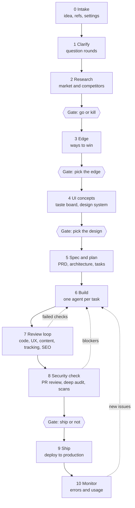

<p align="center">
  <picture>
    <source media="(prefers-color-scheme: dark)" srcset="assets/warsha-logo-dark.svg">
    
  </picture>
</p>
# Warsha · ورشة
 
**From a vague idea to a live, monitored product. Agents do the work. You make four decisions.**
 
Warsha (Arabic for "workshop") is a framework for building software products with Claude agents. You give it a rough idea. It asks questions, researches the market, designs the UI, writes the code, reviews it, checks security, ships it, and watches it in production. A human only steps in at the decisions that matter.
 
> **Status: early.** This is a working spec that we are building and testing in the open. It is not battle-tested yet. Expect changes.
 
## Why
 
Most agent setups help you write code faster. They do not help you decide what to build, make it look good, or know when it is ready. Warsha covers the whole path, and it is built around three ideas:
 
1. **The owner sees decisions, not work.** Everything else stays out of the way.
2. **Builders never review their own work.** Review runs in fresh sessions with fixed checklists.
3. **Trust is earned.** Every stage starts with a human gate and moves to autopilot only when the data says it is safe.
## The pipeline
 

 
| # | Stage | What happens | Output |
|---|---|---|---|
| 0 | Intake | You give the idea, references and settings. The orchestrator asks for what is missing. | Project brief and config file |
| 1 | Clarify | Question rounds turn the idea into scope, users and success measures. | Problem statement |
| 2 | Research | Deep market and competitor research, with sources. | Market brief |
| 3 | Edge | Two or three ways to win, each attacked by a critic agent. | Edge options and a recommendation |
| 4 | UI concepts | References are collected first. Then a taste board, a design system and concepts with real copy. | Chosen design direction |
| 5 | Spec and plan | PRD, architecture, tracking plan, and tasks. | Issues in Linear |
| 6 | Build | One agent per task, each in its own branch, with tests. | Pull requests |
| 7 | Review loop | Fresh agents check code, UX, content, tracking and SEO. Failed work goes back to Build. | Reviewer findings |
| 8 | Security check | Pull request review, a deep audit, and secret and dependency scans. | Security report |
| 9 | Ship | A one-page scorecard, then deploy. | Live product |
| 10 | Monitor | Errors and usage data open new tasks for the build agents. | Issues and a weekly health note |
 
## The four gates
 
The owner decides at four points. Each decision arrives as one short issue with a summary, two or three options, a recommendation, and links to the evidence.
 
1. **Go or kill**, after research
2. **Pick the edge**
3. **Pick the design**
4. **Ship or not**, from the scorecard
A fifth decision, **unstick**, only appears when a stage hits its round cap or budget.
 
## Controls
 
### Effort dials
 
Each stage has its own dial from 1 to 5. The dial sets the model tier, how many options are produced, and how many review rounds run. Presets fill every dial, and you can override any one.
 
| Preset | Use for |
|---|---|
| Spike | Throwaway prototypes |
| Standard | Most work |
| Flagship | Showcase products |
| Design-led | Marketing sites, brand-heavy work |
| Admin tool | Dashboards and back-office tools |
 
Example: `Standard`, with UI at 5 and Research at 2.
 
### Autopilot
 
Each stage runs in one of three modes. You set a project default and override per stage.
 
| Mode | At the end of the stage |
|---|---|
| Gate | Work stops and waits for a decision |
| Notify | Work continues with the agent's pick, and you get a summary |
| Autopilot | Work continues silently, and everything is logged |
 
The first production deploy stays gated by default, even on full autopilot.
 
### Project config
 
One file per project controls everything:
 
```yaml
project: acme-booking
type: client              # client | internal
 
refs:
  competitors: []
  ui_liked: []
  ui_disliked: []
 
effort:
  preset: standard
  overrides:
    ui: 5
    research: 2
 
autopilot:
  default: notify         # gate | notify | autopilot
  stages:
    research: gate
    edge: gate
    ui: gate
    ship: gate
 
stack:
  profile: web            # web | backend-heavy
 
i18n:
  locales: [en]           # add ar for Arabic and right-to-left
```
 
## Quality rules
 
**Design: no slop.**
- No screen is drawn from a blank prompt. Real references are collected first and a taste board is chosen.
- A separate design critic scores every screen against the taste board.
- Public pages aim for award-level quality. Admin screens are minimal and fast, with speed budgets checked on every pull request.
**Content.**
- Copy is written from a product context file and checked by a copy reviewer. No invented numbers or testimonials.
- Images prefer real assets and product screenshots. Generated images start from a written brief and pass a separate image reviewer, or they are dropped.
**Localization by default.**
- All text lives in message files. Layout uses start and end, never left and right.
- Lint rules fail the build on hardcoded text. Adding Arabic means adding one file.
**Monitoring is not optional.**
- Every product ships with Sentry for errors and PostHog for usage.
- Coverage is checked before every ship. Live errors open tasks automatically.
**Security before production.**
- Every pull request gets a security review.
- A deep audit and secret and dependency scans run before ship. Any blocker stops the release.
**SEO and AEO** on every public page: server rendering, metadata, structured data, and clear answers that search engines and AI assistants can quote.
 
### Ship rule
 
Every reviewer returns blockers, majors and minors. A product ships with **zero blockers and at most three majors**.
 
## Stack
 
| Layer | Choice |
|---|---|
| Agents | Claude and Claude Code |
| Design | Claude Design |
| Control and tracking | Linear |
| Language | TypeScript, frontend and backend |
| Frontend | Next.js, React, Tailwind, shadcn/ui on Vercel |
| Database and login | Postgres on Supabase, with Drizzle for migrations |
| Backend-heavy work | Fastify service, BullMQ on Redis |
| Tests | Vitest and Playwright |
| Monitoring | Sentry and PostHog |
 
Web only for now.
 
## How it runs
 
The orchestrator is a single skill, `run-stage`. It reads the config and the project status, runs the stage, saves the output, and moves the status.
 
- **v0:** you run the skill by hand. This is where we are.
- **v1:** a scheduled task checks for ready work every hour.
- **v2:** webhooks trigger agents at once.
State lives in Linear and the repo, never in a chat session. Every stage is safe to run again.
 
## Repo layout
 
| Path | What it is |
|---|---|
| [docs/spec.md](docs/spec.md) | The full build spec |
| [config/warsha.schema.json](config/warsha.schema.json) | JSON Schema for a project's `warsha.yaml` |
| [examples/](examples/) | Example configs for a client project and an internal Spike run |
| [pipeline/stages.yaml](pipeline/stages.yaml) | The eleven stages, their outputs and gates |
| [pipeline/effort.yaml](pipeline/effort.yaml) | Dial levels and presets |
| [skills/run-stage/](skills/run-stage/SKILL.md) | The v0 orchestrator skill (draft) |
| [templates/](templates/) | Decision issue and experiment log templates |
 
Run `npm install` once, then `npm run validate` to check every example config and the pipeline files against the schema. CI runs the same check on every push.
 
## Roadmap
 
- [x] Config schema, stage definitions and effort presets
- [ ] Starter template with monitoring, localization and lint rules
- [ ] `run-stage` skill (v0). A first draft is in `skills/run-stage`.
- [ ] Custom skills: reference scout, design critic, image reviewer, tracking reviewer, scorecard
- [ ] First full run on an internal product
- [ ] First client project
- [ ] Scheduled orchestrator (v1)
- [ ] Maintenance mode for existing products
- [ ] Mobile apps
## Built on
 
Warsha reuses good open work where it exists:
 
- [gstack](https://github.com/garrytan/gstack) for clarify, review, QA and ship skills
- [BMAD Method](https://github.com/bmad-code-org/BMAD-METHOD) for planning agents
- [marketingskills](https://github.com/coreyhaines31/marketingskills) for copywriting
- [Claude Code security review](https://github.com/anthropics/claude-code-security-review) and [Trail of Bits skills](https://github.com/trailofbits/skills) for security
## License
 
To be decided.
 
